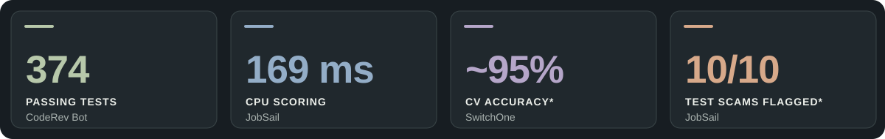
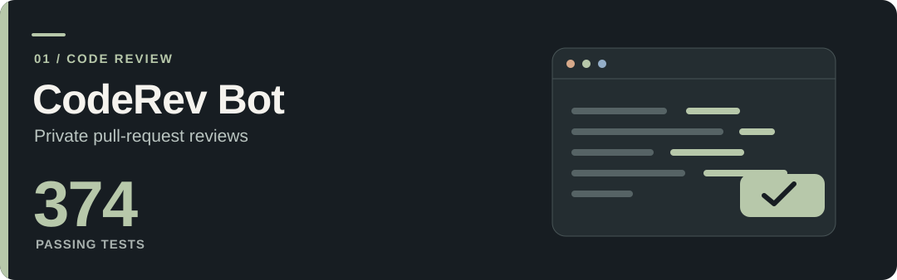
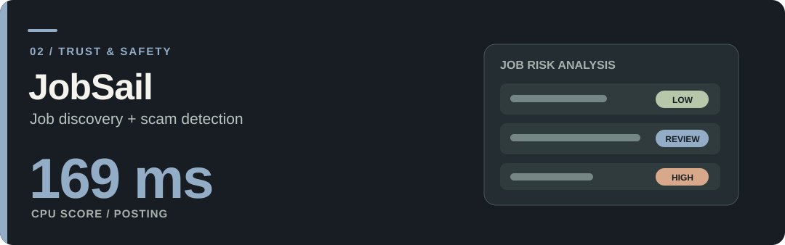
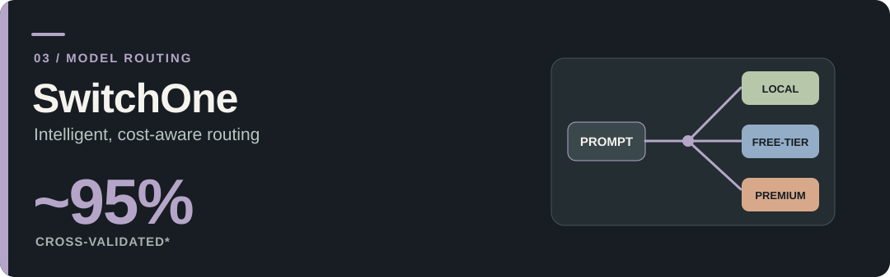
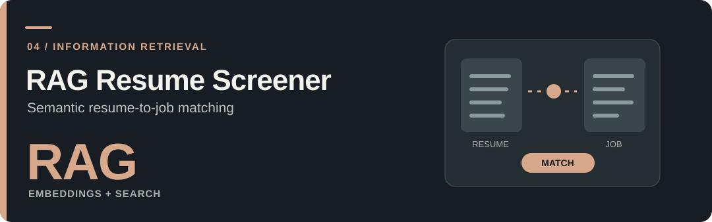
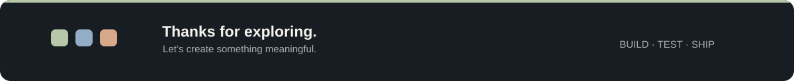

<!-- GitHub profile repository: mayankranjan-dev/mayankranjan-dev -->

  

  <strong>B.Tech Computer Science · ADYP University, Pune · Class of 2027</strong> 
  Software engineering • Applied AI • Backend systems • Data • Problem solving

  
  
  
  

## Selected highlights

Project-level results, not production benchmarks. *SwitchOne: ~95% cross-validated accuracy on 150 hand-labeled prompts. JobSail: 10/10 hand-written adversarial scam examples flagged; the classifier was fine-tuned on 300 synthetic postings.

## Featured work

<table>
<tr>
<td width="50%" valign="top" align="center">
       
          
      <small>Secure webhooks, retry queue, local LLM, Judge0 sandbox.</small> 
      <a href="https://github.com/mayankranjan-dev/coderev"><b>Explore repository ↗</b></a>
    </td>
<td width="50%" valign="top" align="center">
       
          
      <small>Aggregated postings, DistilBERT risk scoring, rule-based guardrails.</small> 
      <a href="https://github.com/mayankranjan-dev/JobSail"><b>Explore repository ↗</b></a>
    </td>
</tr>
<tr>
<td width="50%" valign="top" align="center">
       
         
      <small>Low-latency prompt router with model fallback and escalation.</small> 
      <a href="https://github.com/mayankranjan-dev/switchone"><b>Explore repository ↗</b></a>
    </td>
<td width="50%" valign="top" align="center">
       
         
      <small>Embedding-based retrieval and explainable resume matching.</small> 
      <a href="https://github.com/mayankranjan-dev/rag-resume-screener"><b>Explore repository ↗</b></a>
    </td>
</tr>
</table>

## Technologies I work with

<b>Languages</b>

      

<b>Backend, databases &amp; testing</b>

      

<b>AI, machine learning &amp; data</b>

         

<b>Frontend</b>

  

<b>Developer tools &amp; analytics</b>

      

## Beyond the code

<table>
<tr>
<td width="34%" align="center"><b>Build with purpose</b> Thoughtful features and practical solutions</td>
<td width="33%" align="center"><b>Measure the outcome</b> Testing, accuracy, latency, and failure cases</td>
<td width="33%" align="center"><b>Engineer for reliability</b> Security, fallbacks, CI, and maintainability</td>
</tr>
</table>

**Education** · B.Tech in Computer Science, ADYP University, Pune (expected May 2027)

**Credentials** · Oracle OCI AI Foundations Associate (2026) · EY &amp; Microsoft AI Skills Passport · Anthropic Claude 101 · HackerRank SQL (Intermediate) (2026)

**Experience-based learning** · Deloitte Australia Data Analytics Job Simulation, Forage (2025)

<b>Interested in my work or a collaboration?</b> 
<a href="mailto:mayankranjan.dev@gmail.com">Email</a> · <a href="https://www.linkedin.com/in/mayankranjan1606/">LinkedIn</a> · <a href="https://mayank-portfolio-nine-navy.vercel.app/">Portfolio</a> · <a href="./resume.pdf">Resume</a>

